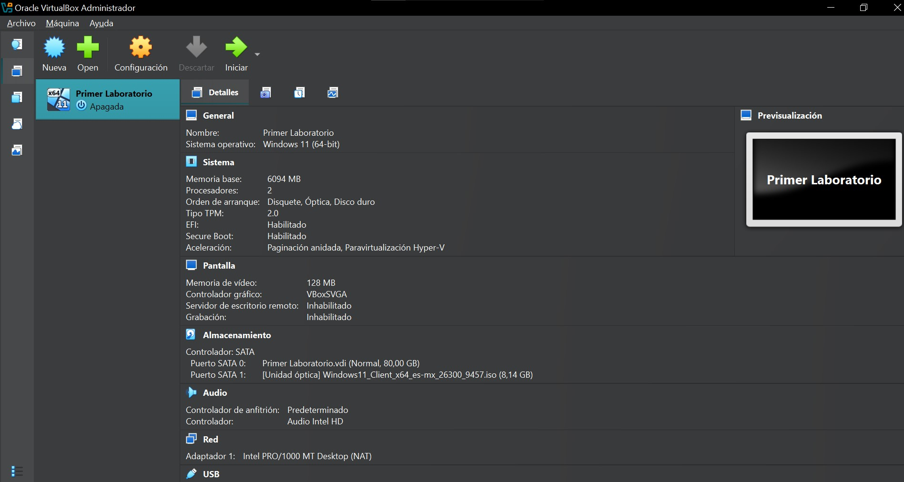
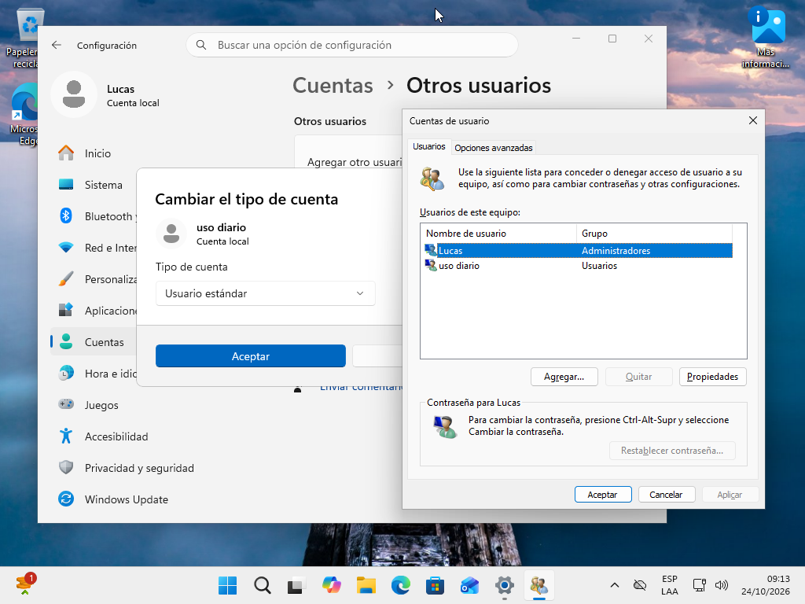
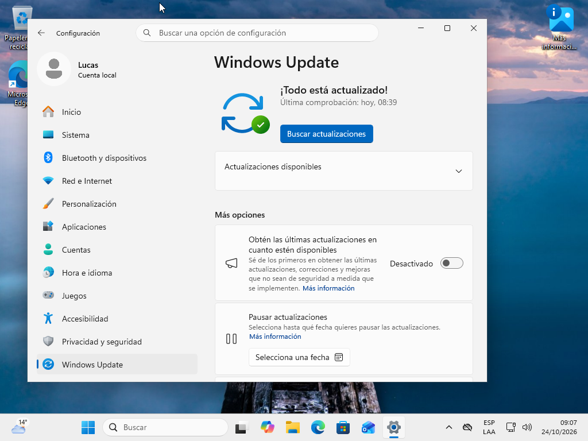
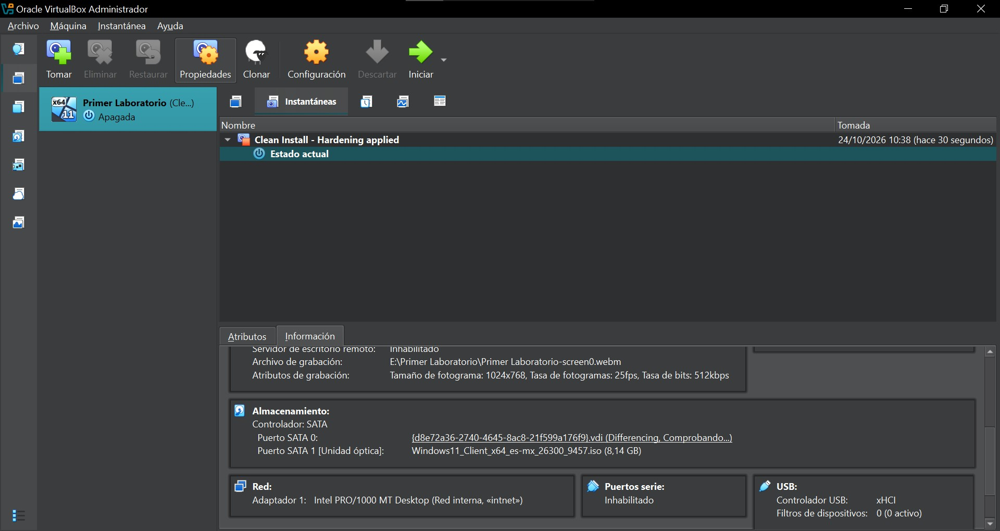

# Reporte Técnico: Mi Primer Laboratorio Seguro de Ciberseguridad
- **Curso:** Ciberseguridad
- **Comisión:** 90885
- **Estudiante:** Lucas Gustavo Decanio
- **Fecha de entrega:** Octubre de 2026
---
## Paso 1: Configuración y aislamiento de red
### Configuración inicial (NAT) y transición a Red Interna (Internal Network)
Inicialmente, el adaptador de red se configuró en modo **NAT** para permitir que la máquina virtual tuviera salida controlada a Internet, facilitando la descarga de parches y actualizaciones de seguridad críticas. Una vez completado este proceso, la interfaz se cambió a **Red Interna** (*Internal Network*).
Este modo aísla de forma absoluta la VM tanto del sistema anfitrión (*Host*) como de Internet y de la red local física, permitiendo únicamente comunicación con otras máquinas virtuales que compartan el mismo segmento de red interna. De esta manera, se garantiza un entorno de contención estricto para análisis y pruebas de ciberseguridad, impidiendo cualquier fuga de tráfico malicioso hacia el exterior.
### ¿Por qué se evita el Modo Puente (Bridge / Adaptador Puente)?
Se descartó explícitamente el uso del **Modo Puente** porque este conecta la máquina virtual directamente a la red física local del hogar o empresa, asignándole una dirección IP dentro del mismo rango que los demás dispositivos. 
Usar modo puente en un laboratorio de seguridad representa un riesgo crítico:

---
## Paso 2: Creación de usuario estándar y principio de mínimo privilegio
Se creó una cuenta de usuario estándar para las tareas operativas diarias y pruebas de software dentro del laboratorio. Esta medida implementa el **principio de mínimo privilegio**, garantizando que el usuario solo cuente con los permisos indispensables para ejecutar programas básicos. 
De esta forma, si se descarga un archivo malicioso o se accede a un sitio comprometido, el daño queda restringido al entorno del usuario y se impide la modificación no autorizada de configuraciones críticas o archivos del sistema que requieren privilegios de Administrador.

---
## Paso 3: Actualizaciones del sistema y mitigación de vulnerabilidades
Se procedió a buscar, descargar e instalar todas las actualizaciones del sistema mediante **Windows Update**, incluyendo parches de seguridad acumulativos y definiciones del antivirus. Esta medida es fundamental dentro del proceso de *hardening* para mitigar vulnerabilidades conocidas y corregir fallos del sistema operativo, reduciendo la superficie de exposición ante posibles amenazas o *exploits*.
| Característica | Red Interna | Solo-Anfitrión (Host-Only) |
| :--- | :--- | :--- |
| Conexión Host ↔ Guest | No | Sí (interfaz virtual privada) |
| Salida a Internet | No | No |
| Comunicación entre VMs | Sí (mismo identificador) | Sí |
| Caso de uso principal | Laboratorios de contención total | Administración segura desde el Host |
**¿Por qué la VM no necesita Internet en esta etapa?**
Una vez aplicadas las actualizaciones y parches de seguridad (mediante NAT en la fase inicial), la salida a Internet debe cortarse siguiendo el principio de mínimo privilegio y contención. Esto asegura que ninguna herramienta de prueba o tráfico del laboratorio filtre hacia el exterior y mantiene el entorno inmutable para las prácticas de ciberseguridad.

---
## Paso 4: Creación de Instantánea (Snapshot) de línea base
Tras completar la configuración inicial, la creación del usuario estándar y la aplicación de parches, se apagó la máquina virtual y se generó una instantánea (*snapshot*) denominada **"Hardening Inicial"** (o *"Clean Install - Hardening applied"*).
Esta acción establece una **línea base segura** y un punto de restauración confiable. Ante cualquier fallo del sistema, infección controlada por malware o prueba destructiva en el laboratorio, permite revertir la máquina a este estado íntegro y limpio en segundos sin necesidad de reinstalar el sistema operativo desde cero.

